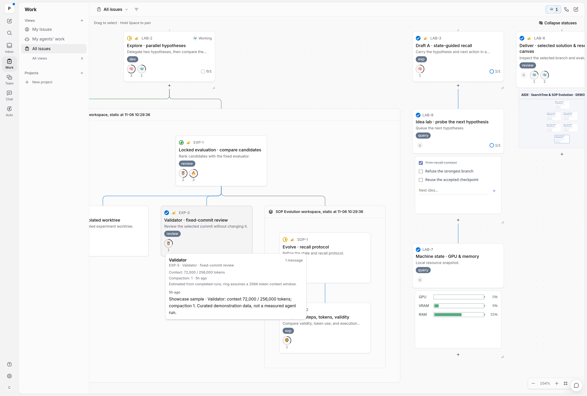
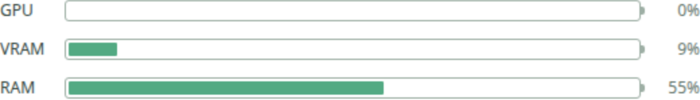
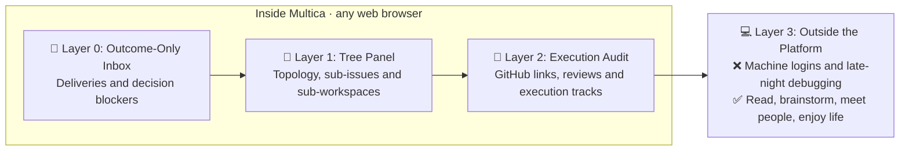
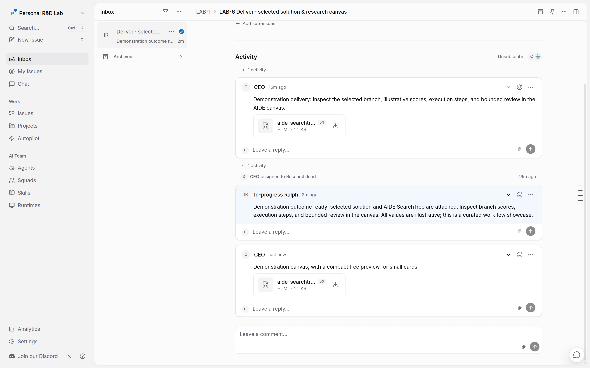
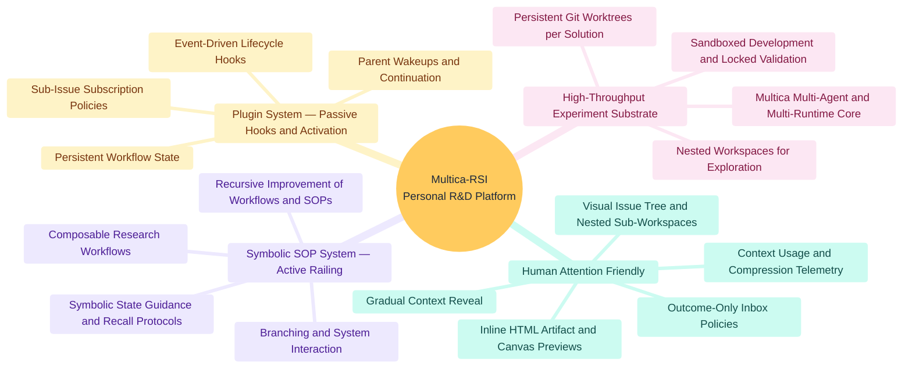

# ⚡ Multica-RSI: The All-in-One Personal R&D Platform

English · [简体中文](README.zh.md)

*Compute is abundant; human attention is the bottleneck. **Bring All Projects, All Agents, and All Machines Inside.** Instead of scattering experiments across fragile scripts, disconnected machines, and noisy terminal tabs, organize parallel exploration, nested sub-workspaces, and evolving SOPs inside one R&D harness.*

  

*Figure 1. Sub-workspace issues and the EXP-3 review; context values are illustrative.*

**Vision:** Turn key system resources and logs into HTML widgets that people can inspect and agents can use.

| Machine state | Idea probing |
| --- | --- |
|  |  |
| *Figure 2. Resource snapshot.* | *Figure 3. Editable idea checklist.* |

## 🧠 Gradual Context Reveal: Engineered for Human Attention

**Layers 0–2 stay inside Multica, accessible from any web browser.** Leave room for life outside the platform.

*Figure 4. Three browser layers, then time away from the screen.*

- **Layer 0 · Outcome-Only Inbox:** Surface final deliveries and decision blockers through programmable notification policies.
- **Layer 1 · Tree Panel:** Scan topology, sub-issues, and sub-workspaces. Inspect context rings and HTML widgets alongside the work.
- **Layer 2 · Execution Audit:** Inspect GitHub links, reviews, and [execution tracks](https://github.com/multica-ai/multica#stay-in-the-loop).
- **Layer 3 · Outside the Platform:** ❌ Machine logins and late-night debugging. ✅ Read, brainstorm, meet people, enjoy life.

  

*Figure 5. Curated outcome notification.*

## 🗺️ Research Mind Map & System Road Map

*Figure 6. Research directions across the four platform pillars.*

### Phase 1: Core Personal R&D Platform

- [x] **Human-attention-friendly control:** Visual Issue Tree, nested workspace snapshots, context telemetry, HTML previews, and configurable subscriptions.
- [x] **Plugin system:** Event-driven hooks and programmable parent wakeup policies.
- [x] **Ralph-style activation:** Continue idle in-progress work after completed or failed runs, respecting active runs, child handoffs, and explicit waits.
- [x] **Harness backup and restore:** Preserve startup prompts, skills, agent configuration, and plugins for restoration to the original workspace.
- [ ] **Complete workspace portability:** Export and replay issues, history, and configuration between workspaces as one supported package.

### Phase 2: Single-Agent Evolving SOPs · In Progress

- [x] **Symbolic SOP system:** Executable states, choices, prechecks, and recall protocols on Multica's multi-agent, multi-machine core.
- [x] **First Symbolic SOP package: [multica-AIDE](https://github.com/Winfred666/multica-AIDE):** Persistent experiment branches, measured search, and optional sandboxed development with locked validation. [Walk through SOP #1](docs/SOP_SHOWCASE.md).
- [ ] **Expandable Symbolic SOP ecosystem:** Domain-specific research packages with reproducible benchmarks and measured SOP improvements.

### Phase 3: Autonomous Delegation & Open R&D Ecosystem

- [ ] **Efficient multi-agent orchestration:** Reproduce useful delegation methods that can work without explicit symbolic SOP guidance.
- [ ] **Metacognitive supervision:** Watchdog and supervisor agents for recovery and domain control.
- [ ] **Customized local desktop:** Research interfaces that help people inspect, steer, and engage.
- [ ] **Long-horizon recovery:** Extend the shipped Ralph continuation policy with bounded stall/timeout recovery and measurable recovery behavior.

## 🔥 The 4 Pillars of Multica-RSI

### 1. Human-Attention-Friendly Control · Gradual Context Reveal

Review outcomes, scan task topology, and inspect evidence from the browser. Open a machine session when investigation requires direct access.

### 2. Symbolic SOP System · Active Railing

Guide agents through explicit states, actions, and recall protocols. Change branching, delegation, and evaluation through SOP skills; evolve those skills alongside the research.

### 3. Plugin System · Passive Hooks & Activation

Use lifecycle hooks to continue work, route reviews, and surface decisions. Plugins control when agents run; SOPs guide what they do.

### 4. High-Throughput Experiment Substrate

Run parallel experiments across projects, agents, and machines with isolated workspaces and configurable execution capacity.

See [multica-AIDE](https://github.com/Winfred666/multica-AIDE) for SearchTree experiments and review workflows.

## 🛠️ Quickstart & Technical Reference

Start with [self-hosting](SELF_HOSTING.md) or the [contributing setup](CONTRIBUTING.md), connect a runtime through the [CLI and daemon guide](CLI_AND_DAEMON.md), and create a workspace. Workspace creation installs the default harness. Then prepare a benchmark and follow [SOP #1](docs/SOP_SHOWCASE.md) to run an AIDE campaign.

- **Workspace Startup Kit & SOP Harness:** [`harness/`](harness/)
- **Hosted Plugin Execution Guide:** [`docs/engineering/hosted-workflow-plugins.md`](docs/engineering/hosted-workflow-plugins.md)
- **CLI & Daemon Configuration:** [`CLI_AND_DAEMON.md`](CLI_AND_DAEMON.md)
- **Self-Hosting & Contributing:** [`SELF_HOSTING.md`](SELF_HOSTING.md) · [`CONTRIBUTING.md`](CONTRIBUTING.md)
- **Agent Development Reference:** [Fork implementation differences](docs/engineering/fork-development.md)
- **Upstream Attribution:** Built on [multica-ai/multica](https://github.com/multica-ai/multica). See [`LICENSE`](LICENSE) and [`NOTICE`](NOTICE).
