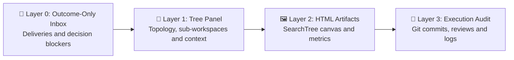
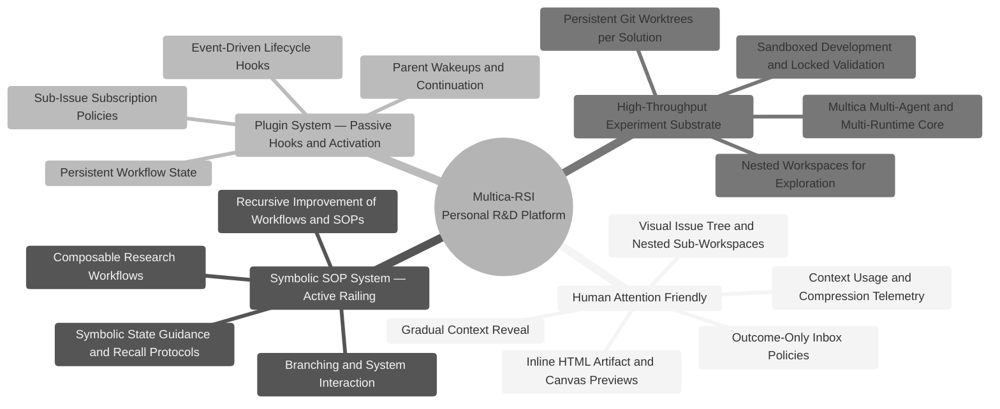

# ⚡ Multica-RSI: The All-in-One Personal R&D Platform

### Unify All Projects, All Agents, and All Machines. Go Deep with Gradual Context Reveal.

*Compute is abundant; human attention is the bottleneck. **Bring Everything Inside.** Instead of scattering experiments across fragile scripts, disconnected machines, and noisy terminal tabs, organize parallel exploration, nested sub-workspaces, and evolving SOPs inside one R&D harness.*

  

*Curated demonstration in the live application. Campaign states and AIDE scores illustrate the workflow.*

The same canvas holds a GPU/memory snapshot and an interactive idea-probing panel alongside experiment trees. Open an HTML artifact to inspect resources or move between Idea, Probe, and Evidence tabs.

| Machine state | Idea probing |
| --- | --- |
|  |  |

## 🧠 Gradual Context Reveal: Engineered for Human Attention

Open the layer you need, from a delivered outcome to the commit and evaluation behind it.

- **Layer 0 — Outcome-Only Inbox:** Configure sub-issue subscriptions and SOP delivery rules so routine child work stays with its parent. Plugins handle parent wakeups; `multica-surface-delivery` and `multica-surface-block` handle verified handoffs and decisions. The Inbox remains available for the notifications you choose to follow.
- **Layer 1 — Visual Tree Panel & Nested Sub-Workspaces:** Scan parent/child relationships, expand collapsed stacks, and open linked workspace snapshots. Inspect agent context rings and compression counts where completed runs provide telemetry.
- **Layer 2 — Inline HTML Artifact Previews:** Inspect uploaded HTML deliverables inside tree cards, then open the interactive artifact viewer. AIDE's SearchTree canvas exposes branches, scores, reviews, and execution timing.
- **Layer 3 — Deep Worktree & Execution Audit:** Inspect a solution's Git commit, evaluation output, bounded refutation, and logs when you need the supporting evidence.

  

## 🗺️ Research Mind Map & System Road Map

### Phase 1: Core Personal R&D Platform

- [x] **Human-attention-friendly control:** Visual Issue Tree, nested workspace snapshots, context telemetry, HTML previews, and configurable subscriptions.
- [x] **Plugin system:** Event-driven hooks and programmable parent wakeup policies.
- [x] **Ralph-style activation:** Continue idle in-progress work after completed or failed runs, respecting active runs, child handoffs, and explicit waits.
- [x] **Harness backup and restore:** Preserve startup prompts, skills, agent configuration, and plugins for restoration to the original workspace.
- [ ] **Complete workspace portability:** Export and replay issues, history, and configuration between workspaces as one supported package.

### Phase 2: Single-Agent Evolving SOPs · In Progress

- [x] **Symbolic SOP system:** Executable states, choices, prechecks, and recall protocols on Multica's multi-agent, multi-machine core; configurable concurrency up to 50 tasks.
- [x] **First Symbolic SOP package: [multica-AIDE](https://github.com/Winfred666/multica-AIDE):** Persistent experiment branches, measured search, and optional sandboxed development with locked validation. [Walk through SOP #1](docs/SOP_SHOWCASE.md).
- [ ] **Expandable Symbolic SOP ecosystem:** Domain-specific research packages with reproducible benchmarks and measured SOP improvements.

### Phase 3: Autonomous Delegation & Open R&D Ecosystem

- [ ] **Efficient multi-agent orchestration:** Reproduce useful delegation methods that can work without explicit symbolic SOP guidance.
- [ ] **Metacognitive supervision:** Watchdog and supervisor agents for recovery and domain control.
- [ ] **Customized local desktop:** Research interfaces that help people inspect, steer, and engage.
- [ ] **Long-horizon recovery:** Extend the shipped Ralph continuation policy with bounded stall/timeout recovery and measurable recovery behavior.

## 🔥 The 4 Pillars of Multica-RSI

### 1. Human-Attention-Friendly Control · Gradual Context Reveal

Follow final deliveries, then open the tree, artifact, or execution evidence on demand. Keep intermediate work in child issues with explicit ownership and review. Nested workspace snapshots let you inspect a campaign's structure without leaving its parent.

### 2. Symbolic SOP System · Active Railing

A symbolic SOP gives an agent an executable next step: inspect the current state, choose an allowed action, satisfy its preconditions, and retain the result for the next recall. Researchers can change branching, delegation, and evaluation procedures in Python skills without editing the platform core. Independent AIDE trees can search both solutions and SOP variants.

### 3. Plugin System · Passive Hooks & Activation

Lifecycle hooks activate work at the right moment. The shipped packages continue idle in-progress issues, wake parents for child review or blockers, and prune stale discussion through a review procedure. Plugins supply activation policy; SOPs guide the work that follows.

### 4. High-Throughput Experiment Substrate

Multica supplies agent runtimes across machines and configurable execution slots. AIDE creates persistent Git worktrees for clients and solution nodes, then branches refinements from selected commits. In `separate` mode, developers run commands through `bubblewrap`; validators keep the evaluator and private data outside candidate repositories.

  

*50 concurrent tasks is a configuration limit, not a measured 50× speedup. Sandbox coverage belongs to the selected workflow. See the [SOP scope and limitations](docs/SOP_SHOWCASE.md#scope-and-limitations).*

## 🛠️ Quickstart & Technical Reference

Start with [self-hosting](SELF_HOSTING.md) or the [contributing setup](CONTRIBUTING.md), connect a runtime through the [CLI and daemon guide](CLI_AND_DAEMON.md), and create a workspace. Workspace creation installs the default harness. Then prepare a benchmark and follow [SOP #1](docs/SOP_SHOWCASE.md) to run an AIDE campaign.

- **Workspace Startup Kit & SOP Harness:** [`harness/`](harness/)
- **Hosted Plugin Execution Guide:** [`docs/engineering/hosted-workflow-plugins.md`](docs/engineering/hosted-workflow-plugins.md)
- **CLI & Daemon Configuration:** [`CLI_AND_DAEMON.md`](CLI_AND_DAEMON.md)
- **Self-Hosting & Contributing:** [`SELF_HOSTING.md`](SELF_HOSTING.md) · [`CONTRIBUTING.md`](CONTRIBUTING.md)
- **Agent Development Reference:** [Fork implementation differences](docs/engineering/fork-development.md)
- **Upstream Attribution:** Built on [multica-ai/multica](https://github.com/multica-ai/multica). See [`LICENSE`](LICENSE) and [`NOTICE`](NOTICE).
