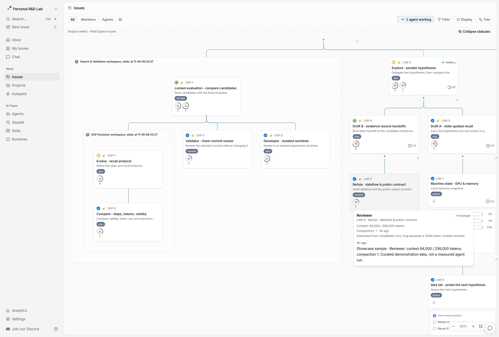
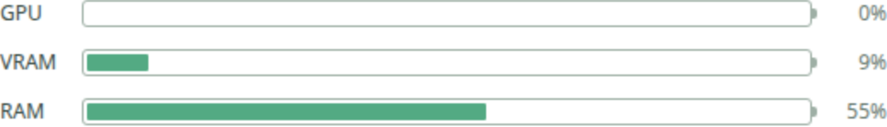
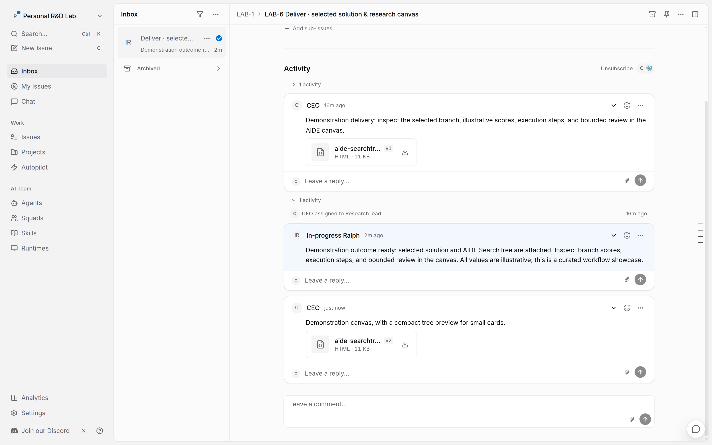
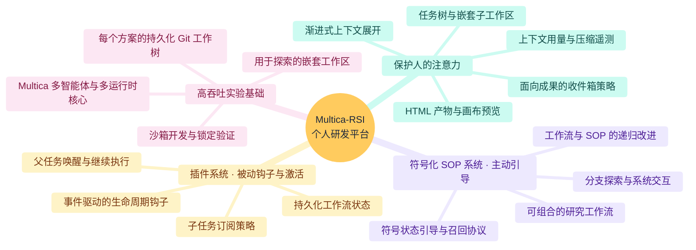
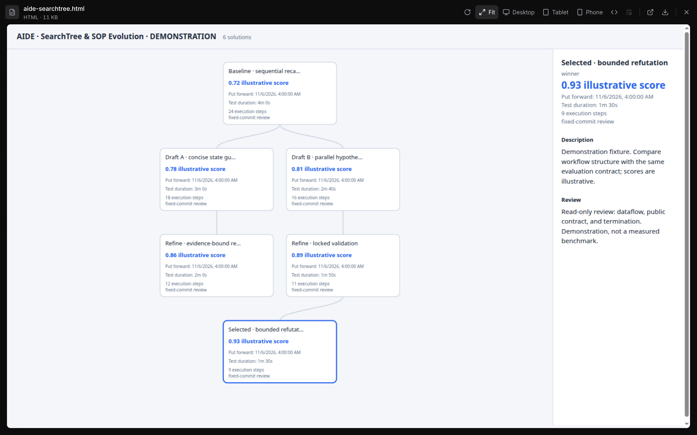

# ⚡ Multica-RSI：一体化个人研发平台

[English](README.md) · 简体中文

*算力充足，人的注意力才是瓶颈。**把所有项目、智能体和机器纳入同一平台。** 在统一的研发环境中组织并行探索、嵌套子工作区和持续演进的 SOP，减少分散的脚本、机器和终端会话。*

  

*图 1：子工作区任务与 LAB-5 评审，上下文数值为示例。*

**愿景：** 将关键系统资源和日志呈现为 HTML 小组件，让人便于查看，让智能体能够使用。

| 机器状态 | 想法探索 |
| --- | --- |
|  |  |
| *图 2：资源快照。* | *图 3：可编辑的想法清单。* |

## 🧠 渐进式上下文展开：保护人的注意力

**第 0–2 层都在 Multica 内完成，可通过任意浏览器访问。** 把时间留给平台之外的生活。

*图 4：前三层通过浏览器访问，然后离开屏幕，享受生活。*

- **第 0 层 · 成果收件箱：** 通过可编程通知策略呈现最终交付和需要决策的阻塞。
- **第 1 层 · 任务树面板：** 查看拓扑、子任务和子工作区，在任务旁查看上下文环和 HTML 小组件。
- **第 2 层 · 执行审计：** 查看 GitHub 链接、评审与[执行轨迹](https://github.com/multica-ai/multica#stay-in-the-loop)。
- **第 3 层 · 平台之外：** ❌ 登录机器、熬夜调试。✅ 阅读、思考、见朋友、丰富生活。

  

*图 5：整理后的成果通知示例。*

## 🗺️ 研究思维导图与系统路线图

*图 6：围绕四个支柱展开的研究方向。*

### 阶段 1：个人研发平台核心

- [x] **保护人的注意力：** 可视化任务树、嵌套工作区快照、上下文遥测、HTML 预览和可配置订阅。
- [x] **插件系统：** 事件驱动钩子与可编程父任务唤醒策略。
- [x] **Ralph 式激活：** 让空闲的 `in_progress` 任务在运行结束或失败后继续执行，并遵守活跃运行、子任务交接和显式等待约束。
- [x] **研发环境备份与恢复：** 保存启动提示词、skill、智能体配置和插件，支持恢复到原工作区。
- [ ] **完整工作区迁移：** 将任务、历史和配置打包导出，并在其他工作区恢复。

### 阶段 2：单智能体 SOP 演进 · 进行中

- [x] **符号化 SOP 系统：** 在 Multica 多智能体、多机器核心上执行状态、选择、前置检查和召回协议。
- [x] **首个符号化 SOP 包：[multica-AIDE](https://github.com/Winfred666/multica-AIDE)：** 持久化实验分支、量化搜索，以及可选的沙箱开发和锁定验证。[查看 SOP #1](docs/SOP_SHOWCASE.md)。
- [ ] **可扩展的符号化 SOP 生态：** 面向具体领域的研究包，配套可复现基准和可量化的 SOP 改进。

### 阶段 3：自主委派与开放研发生态

- [ ] **高效多智能体编排：** 复现无需显式符号化 SOP 引导也能有效工作的委派方法。
- [ ] **元认知监督：** 用看门狗和监督智能体处理恢复与领域约束。
- [ ] **定制本地桌面：** 帮助研究者检查、引导和参与研究的界面。
- [ ] **长周期恢复：** 扩展现有 Ralph 继续执行策略，加入有界的停滞、超时恢复和可度量的恢复行为。

## 🔥 Multica-RSI 的四个支柱

### 1. 保护人的注意力 · 渐进式上下文展开

在浏览器中查看成果、扫描任务拓扑并检查证据。调查需要直接访问系统时，再打开机器会话。

### 2. 符号化 SOP 系统 · 主动引导

通过明确的状态、动作和召回协议引导智能体。用 SOP skill 调整分支、委派和评估流程，让 skill 随研究一起演进。

### 3. 插件系统 · 被动钩子与激活

用生命周期钩子继续任务、安排评审并呈现待决策事项。插件控制何时运行，SOP 引导如何执行。

### 4. 高吞吐实验基础

通过隔离工作区和可配置执行容量，跨项目、智能体和机器开展并行实验。

  

*图 7：AIDE SearchTree，评分与评审步骤为示例。*

## 🛠️ 快速开始与技术参考

先按[自托管指南](SELF_HOSTING.md)或[开发环境说明](CONTRIBUTING.md)完成安装，再通过 [CLI 与守护进程指南](CLI_AND_DAEMON.md)连接运行时并创建工作区。创建工作区时会安装默认研发工具包。准备基准任务后，按 [SOP #1](docs/SOP_SHOWCASE.md)开展 AIDE 研究。

- **工作区启动工具包与 SOP 环境：** [`harness/`](harness/)
- **托管插件执行指南：** [`docs/engineering/hosted-workflow-plugins.md`](docs/engineering/hosted-workflow-plugins.md)
- **CLI 与守护进程配置：** [`CLI_AND_DAEMON.md`](CLI_AND_DAEMON.md)
- **自托管与贡献：** [`SELF_HOSTING.md`](SELF_HOSTING.md) · [`CONTRIBUTING.md`](CONTRIBUTING.md)
- **智能体开发参考：** [分支实现差异](docs/engineering/fork-development.md)
- **上游归属：** 基于 [multica-ai/multica](https://github.com/multica-ai/multica)。参见 [`LICENSE`](LICENSE) 和 [`NOTICE`](NOTICE)。
