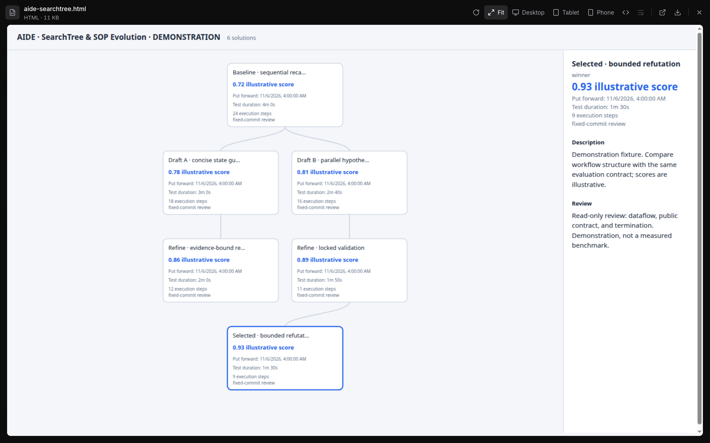

# SOP #1: AIDE Research Campaigns

[multica-AIDE](https://github.com/Winfred666/multica-AIDE) is the first packaged research SOP for Multica-RSI: describe candidate solutions, evaluate them against a fixed contract, retain each measured branch, and refine the strongest result until the requested goal holds. Researchers can use the installation/client SOP pair or embed `SearchTree` in a larger research loop.



*The showcase uses a curated demonstration campaign. Its scores and execution steps illustrate presentation; they are not benchmark measurements.*

## Symbolic SOPs as Active Railing for Personal R&D

A symbolic SOP turns a procedure into named states, allowed choices, and executable actions. The agent reads the current instruction, supplies the required evidence, and follows a returned command. Read-only prechecks inspect the live platform or repository before an action and verify the resulting state. Saved task records carry progress across recalls.

The [Python startup kit](../harness/README.md) installs the workspace prompt, system skills, library skills, and plugin packages through native APIs. Its [manifest](../harness/manifest.json) selects what the workspace receives. Researchers edit the prompt or install a skill to change an experimental procedure without changing the backend.

| Mechanism | Responsibility | Example |
| --- | --- | --- |
| Symbolic SOP | Guide choices and verify state transitions | Describe an idea before its official test; record the measured JSON before selecting another branch |
| Recall protocol | Resume with saved evidence and the next allowed action | Continue an evaluation monitor after a time or log trigger |
| Passive plugin | Activate a native task after a lifecycle event | Wake a parent when a child requests review |
| Platform | Store issues, assignments, files, runtime state, and notifications | Keep experiment ownership and delivery evidence attached to the issue |

The shipped [plugins](../harness/plugins/README.md) handle parent wakeups, Ralph continuation, and comment/thread pruning. Their hooks schedule ordinary work; the SOP determines what that work does. This separation supports complex experimental trees without putting each research policy in core code.

## End-to-End Walkthrough

### 1. Trigger and provisioning

Create a parent issue with a measurable research objective. Prepare a dedicated benchmark repository or branch with public inputs and a task brief in `AGENTS.md` or `AGENTS.d`. From a multica-AIDE checkout, enter the installer:

```sh
python3 run.py install
```

Follow the returned choices using the native task's `MULTICA_*` credentials. The [installation SOP](https://github.com/Winfred666/multica-AIDE/blob/main/multica_aide/skills/multica-aide-install/SKILL.md) prepares the benchmark and settings, then creates client issues. It commits the prepared template with the local client SOP and checks out persistent Git worktrees beneath the configured `workdirs` directory. Each solution node records its own worktree and commit; a refinement branches from the selected node's commit.

Use linked sub-workspaces when a campaign needs a separate playground for its issues and configuration. The Tree Panel recognizes an issue's `sub_workspace_id` and shows that workspace's snapshot, including further nested links. Platform workspaces and Git worktrees serve different purposes: the first organizes research state; the second preserves code candidates. AIDE's installer creates client issues and worktrees in its current workspace. Creating a platform sub-workspace is a separate provisioning step.

### 2. Sandboxed development and locked validation

Copy AIDE's `config.yaml` to ignored `config.local.yaml`. Select `mode: separate` for this workflow and configure the exact developer and validator agent names.

The validator owns the AIDE client SOP and official evaluator. Each client reuses a persistent developer child. The developer works on public data through the supplied `bubblewrap` command launcher, which hides private paths, disables network access, and permits writes to the candidate and temporary files. Keep private datasets, the evaluator, and the benchmark contract outside candidate repositories.

The benchmark defines:

| Contract | Purpose |
| --- | --- |
| `evaluate_argv` | Run the official test against `{solution}` and return a JSON delivery |
| `validate(solution) -> bool` | Check the submitted delivery format, following AIDE's contract interface |
| `score(delivery) -> number` | Rank valid deliveries; use `maximize: false` for losses |
| `is_complete(delivery) -> bool` | Express the requested measurable exit condition |

The [client SOP](https://github.com/Winfred666/multica-AIDE/blob/main/multica_aide/skills/multica-aide-cli/SKILL.md) checks benchmark integrity, registers an idea before testing, and monitors the official evaluation. Keyword and time triggers return new output with `continue` and `exception` choices. After test completion, the client records the full delivery and a review paragraph. It checks that the recorded result belongs to the tested commit before scoring it.

### 3. Bounded read-only refutation

Compose a refutation step with the native child-issue and review SOPs when the campaign needs an independent audit. Give the reviewer a fixed candidate commit, the public contract, a named dataflow or correctness question, a bounded scope, and a read-only assignment. Keep its report attached to that candidate; a changed candidate needs new evidence.

Use [multica-subissue-distribute](../harness/skills/multica-subissue-distribute/SKILL.md) for parent dispatch and [multica-subissue-review](../harness/skills/multica-subissue-review/SKILL.md) for parent acceptance. The parent reads the delivered evidence, requests a concrete correction or cancellation when necessary, and accepts only reviewed delivery replies in review. Code acceptance requires the delivered commit and an integration verification command. Explicit experiment groups compare the completed group and can retain the baseline when it wins.

AIDE's built-in review paragraph and an independent refutation child are separate steps. The campaign SOP must request the child audit; the standalone AIDE package does not create an independent refutation for every candidate.

### 4. Surface delivery

When the requested goal holds, use [multica-surface-delivery](../harness/skills/multica-surface-delivery/SKILL.md). Follow its verification and report callbacks, attach the selected result and supporting canvas, and complete the returned handoff. Children submit to parent review; the parent owns acceptance and the final human-facing delivery. Use `multica-surface-block` when an external blocker requires a decision.

For an outcome-focused Inbox, configure inherited sub-issue following and follow the campaign's final handoff. Routine child discussion remains available in its issue. Plugin-driven parent wakeups let agents process review and blockers without requiring a human to follow each child.

The uploaded HTML appears in the tree as a deliverable. Open it for branch scores, reviews, and timing; inspect the selected worktree and evaluation logs when you need the underlying evidence.

## Contributor Template: Author, Plug In, Benchmark

Start from [create-symbolic-sop](../harness/skills/create-symbolic-sop/SKILL.md) and its [standalone template](../harness/skills/create-symbolic-sop/assets/template/). Keep the entry instructions short and put procedure logic in Python:

```text
multica-your-research-sop/
├── SKILL.md          # Trigger, required inputs, entry command, recall instructions
├── controller.py    # States, choices, actions, and live prechecks
├── sop.py           # State/Option/Workflow objects from the template
└── wrapper.py       # Entry point and persisted task state
```

1. **Define the research contract.** Specify public inputs, candidate output, evaluator, ranking direction, budget, and measurable completion condition. Keep the baseline and evaluation resources fixed across comparisons.
2. **Encode the procedure.** Export one `Workflow(...)` with one initial state and explicit final states. Give each `Option` its action and required parameters. Use read-only prechecks for evidence gates and saved state for recalls. Preserve live state when updating an installed skill.
3. **Install through the skill APIs.** Add the skill to a workspace and attach it to the relevant agent. For a default harness contribution, update `harness/manifest.json`. Add a plugin only when the procedure needs a lifecycle activation policy; reuse the [hosted plugin contract](engineering/hosted-workflow-plugins.md).
4. **Validate structure and behavior.** Run `python3 <skill-directory>/wrapper.py --validate`. Cover the procedure's meaningful state transitions, failed evidence gates, and resumption behavior with focused tests before running a live benchmark.
5. **Benchmark the workflow.** Follow [AIDE's benchmark contract](https://github.com/Winfred666/multica-AIDE/blob/main/AGENTS.md). Record the input dataset/version, baseline commit, candidate commit, evaluator command, full delivery JSON, score, elapsed time, and measured resource use. Report goal attainment and failure cases alongside cost. Compare SOP variants on the same task and budget.

For nested RSI, give the solution search and SOP search independent tree directories. Embed `SearchTree` and `render_tree` between your application's phases; the caller owns development, evaluation, restoration, and termination. Presentation labels such as execution steps or recorded tokens come from the caller. They do not change the numeric ranking function.

## Scope and Limitations

- **AIDE modes:** `val_dev` is the default and combines development and validation in one issue. Locked validation requires explicit `separate` mode. Its sandbox covers development commands, not the agent conversation or platform API access.
- **Inbox policy:** Outcome-only delivery is a configured research workflow. Mentions, followed issues, assignments, and other selected subscriptions can still notify you. A screenshot demonstrates a presentation state, not suppression under every event sequence.
- **Snapshots and artifacts:** Embedded sub-workspaces are static snapshots with capture timestamps. Uploaded HTML preserves the delivered artifact; it is not automatically a connection to a running AIDE server. A separately served SearchTree can poll its own tree endpoint.
- **Concurrency and telemetry:** 50 is the configurable agent/daemon task limit, not a throughput measurement or a guarantee that every runtime is sandboxed. Context rings use provider telemetry where available; the current tree uses an assumed 256k context window for ring proportions.
- **Backup and restore:** The shipped [harness backup skill](../harness/skills/harness-backup-restore/SKILL.md) restores prompts, skills, agent configuration, and plugins to their original server/workspace. It preserves issues, projects, and task history; it does not serialize them into a complete cross-workspace clone or recover secrets omitted by the API.
- **Research evidence:** The screenshots use demonstration data. This document describes the implemented SOP package and its composition points, not a published production benchmark result.
