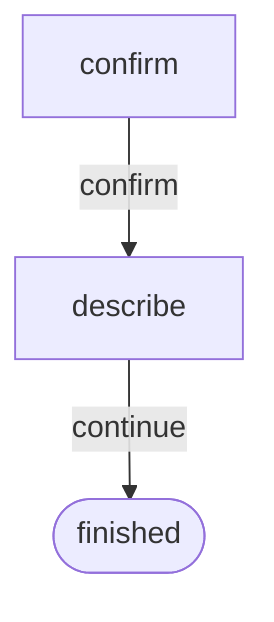
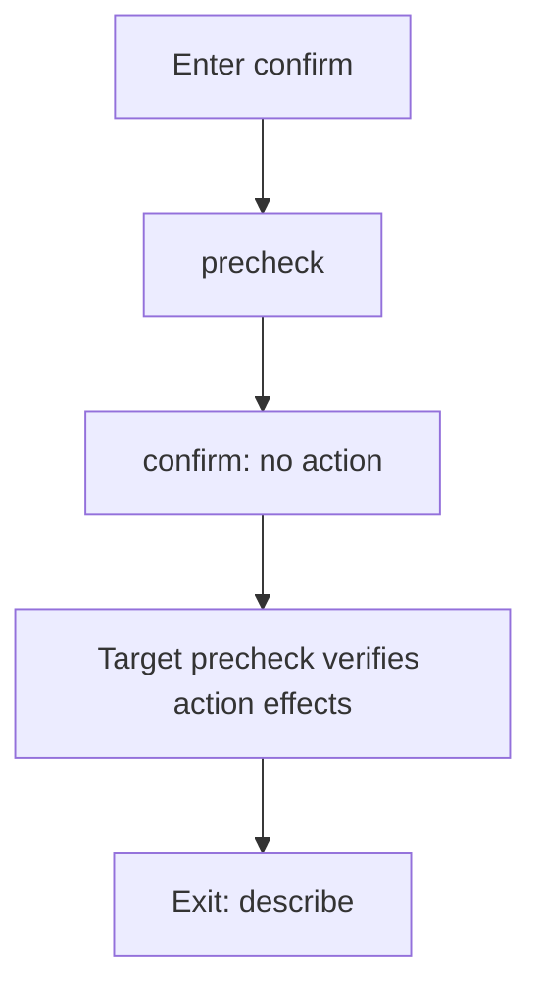
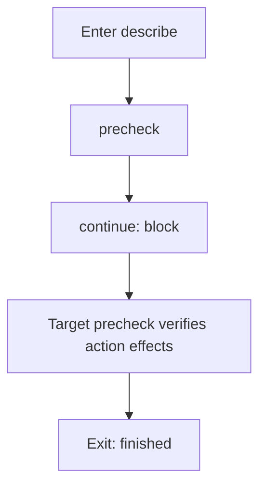
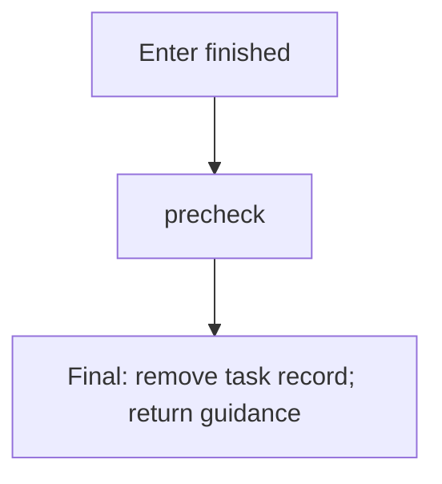
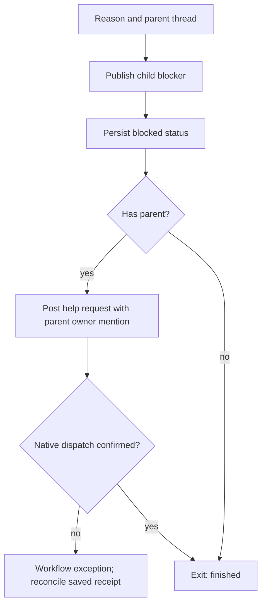

Runtime assertion recovery: the current or target precheck enters `error`;
one `repaired` callback resumes the saved check without repeating a completed
action. A repeated assertion failure enters `blocked`. `quit` is available only
at the initial state and deletes the task record. Workflow exceptions retain state.

State: confirm

State: describe

State: finished

State: describe

